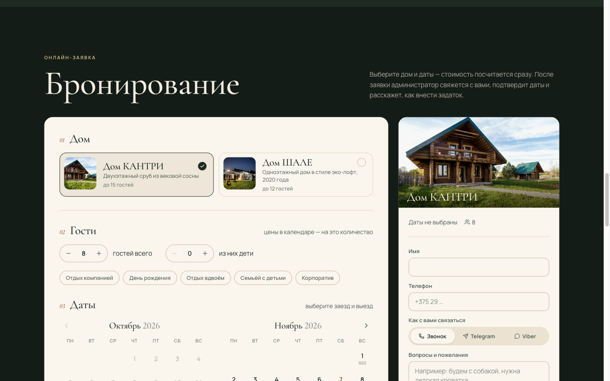
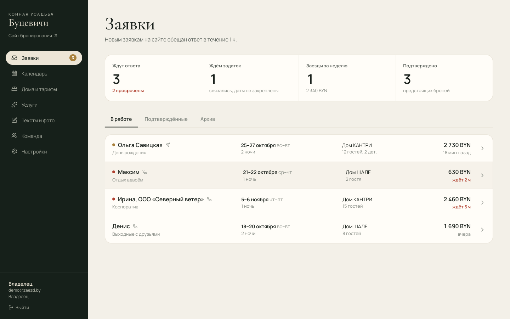
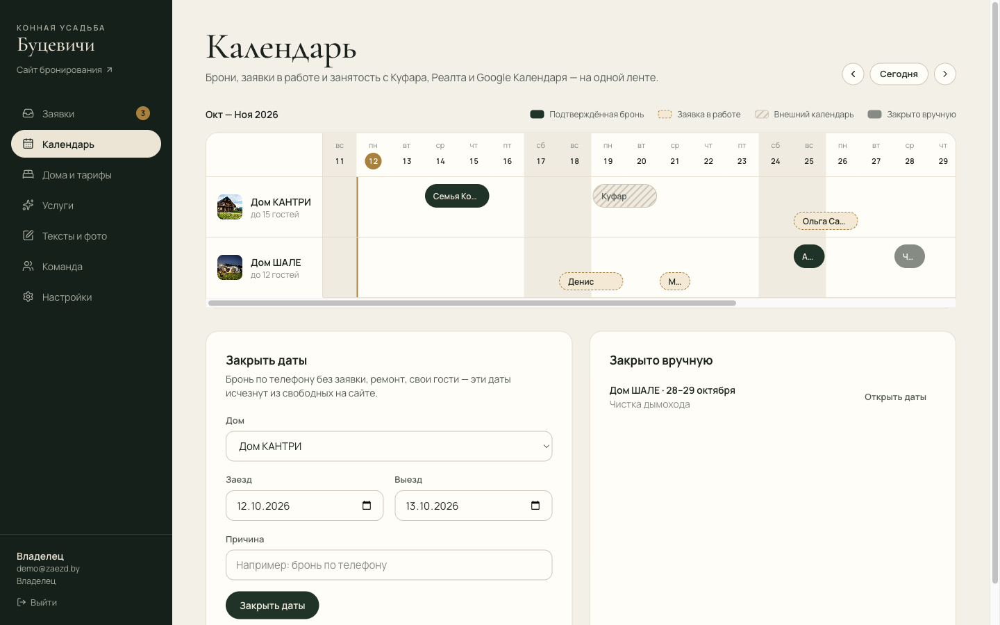
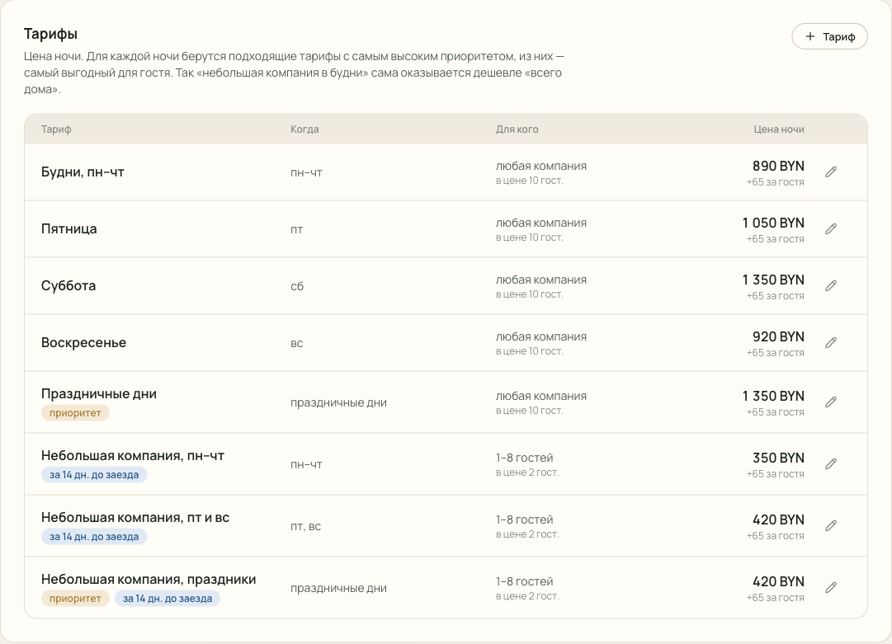
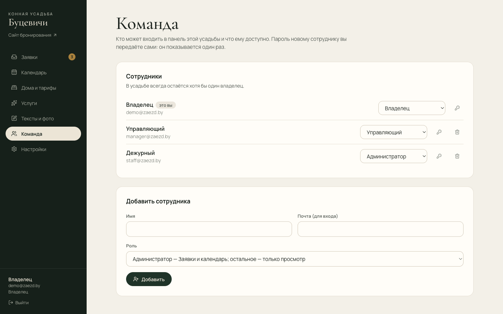

# Заезд — модуль бронирования для усадеб

Модуль бронирования для загородных усадеб: календарь свободных дат, расчёт стоимости по настоящим правилам площадки, заявка на бронь и панель, в которой владелец сам ведёт дома, цены, фото и тексты.

Демо работает на реальных данных конной усадьбы «Буцевичи» (verhom.by): два дома, их цены, условия брони и допуслуги взяты с сайта усадьбы. Заявки в демо выдуманные.



| Заявки | Календарь двух домов |
|---|---|
|  |  |
| **Редактор тарифов** | **Команда и роли** |
|  |  |

## Что умеет

**Для гостя** (`/u/butsevichi`, оформление в стиле сайта усадьбы):
- Выбор дома, состава компании и дат. В календаре под каждой датой видна цена ночи для выбранного числа гостей, занятые даты зачёркнуты.
- Сразу считается полная стоимость: тарифы по дням недели, праздники, тариф для небольшой компании, доплата за гостей сверх базы, скидка с третьей ночи. К этому добавляются баня, прогулки и кухня с количеством, и тут же показан задаток.
- Если выгодный тариф ещё не открыт, гость видит пояснение. Например: «малые компании — не раньше чем за две недели».
- Форму можно вставить в любой сайт одной строкой (`/embed.js`).

**Для владельца** (`/admin`, тестовые входы — в таблице ниже):
- **Заявки:** новые, ждём задаток, подтверждённые. Просроченные заявки подсвечиваются. В карточке есть расчёт по ночам, пересечения с другими бронями, история и заметки к звонкам.
- **Календарь:** оба дома на одной ленте. На ней брони, заявки в работе, занятость с Куфара, Реалта и Google, а также даты, закрытые вручную.
- **Дома и тарифы:** создание домов, фото (загрузка, обложка, порядок), описание и удобства. В редакторе тарифов задаются дни недели, праздники, период, состав компании, окно бронирования и приоритет. Встроенная проверка расчёта показывает, какой тариф сработал в каждую ночь.
- **Услуги, тексты и фото, праздничные дни.**
- **Настройки:** показывать ли занятость, как показывать цену (точно, ориентиром или не показывать), процент задатка, уведомления в Telegram, синхронизация календарей через iCal, код для вставки на сайт.

## Роли и права

Три роли с правами, которые проверяет сервер (подробно — в [docs/ROLES.md](docs/ROLES.md)). Все пароли в демо — `demo`.

| Почта | Роль | Может |
|---|---|---|
| `demo@zaezd.by` | Владелец | Всё: настройки, реквизиты, календари, удаление, команда |
| `manager@zaezd.by` | Управляющий | Дома, тарифы, услуги, тексты, заявки, календарь; без удаления, настроек и команды |
| `staff@zaezd.by` | Администратор | Заявки и календарь; остальное только смотреть |

Права описаны одной таблицей в `lib/permissions.ts`; каждое действие в `app/admin` начинается с `requirePermission(...)`. Роль берётся из базы, а не из cookie, поэтому понижение действует сразу. Владелец управляет командой на странице `/admin/team`: добавление, смена роли, новый пароль, удаление; в усадьбе всегда остаётся хотя бы один владелец.

## Как устроено

- **Next.js 16, React 19, TypeScript.** Server Components и Server Actions.
- **PostgreSQL и Prisma.** Двойная бронь запрещена самой базой: ограничение `EXCLUDE USING gist` по `daterange(checkIn, checkOut)` действует для подтверждённых броней. Оно сработает, даже если два администратора нажмут «Подтвердить» одновременно.
- **Расчёт цены — чистая функция** `lib/quote.ts`. Её используют сайт, админка и проверка тарифов. Сервер всегда пересчитывает цену сам и не доверяет браузеру. Тесты написаны на реальных ценах дома КАНТРИ.
- **Выбор тарифа на ночь.** Из подходящих по дате, числу гостей и окну бронирования берётся группа с наибольшим приоритетом, а в ней — самый выгодный для гостя тариф. Поэтому «небольшая компания в будни» сама оказывается дешевле «всего дома», а праздник перебивает обычный день.
- **iCalendar (RFC 5545).** Своя реализация экспорта и разбора лент.
- **Мультиарендность.** Каждое серверное действие проверяет, что данные принадлежат усадьбе из сессии.
- **Безопасность.** Сессия — подписанный JWT в httpOnly-cookie, в продакшене без `JWT_SECRET` сервер не стартует сессии. Ограничение попыток входа (по адресу и по почте) и потока заявок. Загрузка чужих iCal-лент идёт только на публичные адреса: проверяются настоящие IP после DNS и каждый редирект, ответ ограничен по размеру (`lib/safeFetch.ts`). Загрузка файлов — только фото, по списку типов, без выхода из папки.

## Запуск

Нужны Node 20+ и PostgreSQL 14+.

1. Создайте файл настроек из примера и укажите в нём `DATABASE_URL` и `JWT_SECRET`:
   ```bash
   cp .env.example .env
   ```
2. Установите зависимости:
   ```bash
   npm install
   ```
3. Создайте таблицы:
   ```bash
   npx prisma migrate deploy
   ```
4. Заполните базу данными «Буцевичей». Вход: `demo@zaezd.by` / `demo`.
   ```bash
   npm run db:seed
   ```
5. Запустите проект, он откроется на http://localhost:4195:
   ```bash
   npm run dev
   ```
6. Проверки:
   ```bash
   npm run typecheck   # типы
   npm test            # юнит-тесты: расчёт цены, iCal, права, защита ссылок и секрета
   npm run test:int    # серверный код против PostgreSQL (нужна база usadba_test, см. vitest.int.config.mts)
   ```
   Всё это же выполняет GitHub Actions (`.github/workflows/ci.yml`) на каждый push.

## Что уточнить у клиента

Спорные места помечены `TODO` в `prisma/seed.ts`:
- **Цена для небольшой компании в пт и вс:** на одной странице сайта 420, на другой 450.
- **Вместимость КАНТРИ:** на сайте встречается 14, 15 и 10 + 4.
- **Праздничные дни:** считаются ли праздничными предновогодний период и летний сезон.

## Дальше

- Онлайн-задаток через bePaid или Express-Pay (ЕРИП).
- Автообновление внешних календарей по расписанию.
- Хранилище фото для продакшена (S3 или Vercel Blob) вместо локальной папки `uploads/`.
- Коммерческое предложение и «скинуться компанией»: код есть в истории, коммит `b0f36af`, сейчас выключено.
